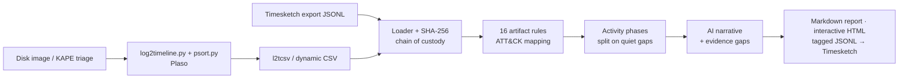

# AI Digital Forensics Timeline Assistant


A DFIR home-lab tool that takes a **Plaso / log2timeline super-timeline** (or a Timesketch export),
flags forensically interesting artifacts (Prefetch, registry USBSTOR, LNK files, browser history,
event logs) with **16 rules mapped to MITRE ATT&CK**, groups them into activity phases and writes an
**AI-drafted investigation narrative** that notes gaps and other possible explanations. It records the
evidence file's **SHA-256** for chain of custody, and exports a tagged timeline you can import back
into **Timesketch**.

> **Target role:** Digital Forensics Analyst · Computer Forensics Examiner · DFIR / Incident Response Analyst · E-Discovery Analyst

## Workflow



## Detection rules

| ID | Artifact rule | Sources | ATT&CK |
|---|---|---|---|
| DF-01 | Credential dumping tool (mimikatz, procdump, nanodump) | Prefetch, EVT | T1003.001 |
| DF-02 | Remote execution (PsExec, PAExec, WMIC) | Prefetch, EVT | T1569.002 |
| DF-03 | Discovery tools (AdFind, SharpHound, Advanced IP Scanner) | Prefetch | T1046, T1087.002 |
| DF-04 | Archiving user data (7-Zip, WinRAR) | Prefetch, $MFT | T1560.001 |
| DF-05 | Cloud sync / transfer tools (rclone, MEGAsync, WinSCP) | Prefetch | T1567.002 |
| DF-06 | File-sharing / paste site visits | Browser history | T1567.002 |
| DF-07 | Executable or archive downloaded | Browser history | T1105 |
| DF-08 | USB mass storage connected | Registry (USBSTOR, MountedDevices) | T1052.001 |
| DF-09 | File opened from removable drive | LNK, Jump Lists | T1052.001 |
| DF-10 | Event log cleared (1102 / 104) | EVTX | T1070.001 |
| DF-11 | Service installed (7045) | EVTX | T1543.003 |
| DF-12 | Scheduled task created (4698) | EVTX, $MFT | T1053.005 |
| DF-13 | RDP logon (4624 type 10 / 1149) | EVTX | T1021.001 |
| DF-14 | Run-key persistence | Registry | T1547.001 |
| DF-15 | Shadow copies deleted | Prefetch, EVTX | T1490 |
| DF-16 | Anti-forensics tools (SDelete, wevtutil, CCleaner) | Prefetch | T1070.004 |

## Quick start

```bash
git clone https://github.com/Shanker869/ai-forensics-timeline-assistant.git
cd ai-forensics-timeline-assistant
python data/make_sample.py
python -m dfir_timeline.cli data/sample_timeline_l2t.csv --case-notes "HR suspects a leak of employee records" --examiner "Your Name"
pip install pytest && pytest -q
```

The sample case is an insider-theft scenario (made up): after hours the user visits MEGA, downloads
rclone, compresses HR data with 7-Zip, copies it to a SanDisk USB drive, then runs SDelete and clears
the Security and System logs. Outputs:
[`examples/timeline_report.md`](examples/timeline_report.md) ·
[`examples/timeline.html`](examples/timeline.html) (open in a browser: search and filter by tag) ·
[`examples/tagged_timeline.jsonl`](examples/tagged_timeline.jsonl)

### On a real image (your own lab VM)

```bash
# Plaso (docker is easiest)
docker run -v $PWD:/data log2timeline/plaso log2timeline.py --storage-file /data/case.plaso /data/disk.E01
docker run -v $PWD:/data log2timeline/plaso psort.py -o l2tcsv -w /data/timeline.csv /data/case.plaso
python -m dfir_timeline.cli timeline.csv --case-notes "..."
```

For fast triage, collect artifacts with KAPE (`!SANS_Triage` target) and run Plaso on the collection.
Import `tagged_timeline.jsonl` into Timesketch to review the flagged events with your team.

Turn on the AI narrative with `LLM_PROVIDER=ollama | openai | anthropic`. Without a model, a
rule-based phase summary is written. The narrative is told to say "indicates", not "proves". It is a
triage aid; every finding has to be checked against the original evidence.

## Layout

```
dfir_timeline/
  timeline.py   Plaso l2tcsv / dynamic CSV / Timesketch JSONL loaders, SHA-256, Timesketch export
  analyze.py    16 artifact rules, phase grouping, ATT&CK table, AI narrative
  cli.py        report, interactive HTML timeline, exports
```

## Skills shown

Super-timeline analysis · Windows artifacts (Prefetch, USBSTOR, LNK, EVTX, browser history) ·
chain of custody · Plaso / Timesketch · MITRE ATT&CK · forensic report writing · Python · LLMs

## References and credits

Built while studying (no code copied):
[log2timeline/plaso](https://github.com/log2timeline/plaso) ·
[google/timesketch](https://github.com/google/timesketch) ·
[sleuthkit/autopsy](https://github.com/sleuthkit/autopsy) ·
[volatilityfoundation/volatility3](https://github.com/volatilityfoundation/volatility3) ·
[EricZimmerman/KapeFiles](https://github.com/EricZimmerman/KapeFiles) ·
[WithSecureOpenSource/chainsaw](https://github.com/WithSecureOpenSource/chainsaw)

## License

MIT
