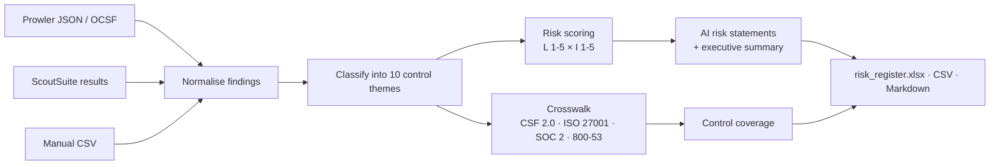

# AI-Assisted GRC Risk Assessment Tool


Turns raw cloud security scans from **Prowler** and **ScoutSuite** into what a GRC team actually
delivers: a **scored risk register** (likelihood × impact, owner, due date, treatment), a
**heat map**, and **control coverage** against **NIST CSF 2.0, ISO/IEC 27001:2022 Annex A,
SOC 2 and NIST SP 800-53**. An LLM drafts the risk statements ("If… then… resulting in…") and a
CISO-level executive summary.

> **Target role:** Junior GRC Analyst · IT Risk Analyst · Information Security Compliance Analyst · Security Audit Associate

## Pipeline



## Scoring method

| Factor | Rule |
|---|---|
| **Likelihood** (1-5) | 1 + affected resources (≥2, ≥5, ≥15) + 1 if internet/public/root exposure |
| **Impact** (1-5) | worst finding severity (low=2 … critical=5) + 1 if a crown-jewel asset is affected |
| **Rating** | score = L × I → 1-4 Low · 5-9 Medium · 10-19 High · 20-25 Critical |
| **Due date** | Critical 14 days · High 30 · Medium 90 · Low 180 |

## Quick start

```bash
git clone https://github.com/Shanker869/ai-grc-risk-assessment-tool.git
cd ai-grc-risk-assessment-tool
pip install -r requirements.txt pytest
python data/make_samples.py
python -m grc_tool.cli data/prowler_sample.json data/scoutsuite_sample.js --crown-jewel prod-customer
pytest -q
```

Example outputs: [`examples/risk_assessment.md`](examples/risk_assessment.md) ·
[`examples/risk_register.xlsx`](examples/risk_register.xlsx) ·
[`examples/control_coverage.json`](examples/control_coverage.json)

### Run it on your own cloud account

Use a free-tier AWS account you own with a **read-only** IAM role (SecurityAudit + ViewOnlyAccess):

```bash
pip install prowler scoutsuite
prowler aws --output-formats json-ocsf -o prowler-out
scout aws --report-dir scout-out
python -m grc_tool.cli prowler-out/*.ocsf.json scout-out/scoutsuite-results/scoutsuite_results_*.js
```

Turn on AI writing with `LLM_PROVIDER=ollama | openai | anthropic` (see `.env.example`).
Without a model, template statements are used.

## Control themes

Identity & MFA · Least privilege · Logging & monitoring · Encryption at rest · Encryption in transit ·
Network exposure · Public data exposure · Backup & resilience · Vulnerability management ·
Secure configuration. See [`grc_tool/controls.py`](grc_tool/controls.py) for the keywords and crosswalk.

> The crosswalk is a simplified lab mapping. For audit work, verify against the official
> NIST CSF 2.0 informative references, ISO/IEC 27002:2022 and the AICPA Trust Services Criteria.

## Skills shown

Risk assessment methodology · risk register design · NIST CSF 2.0 / ISO 27001 / SOC 2 / NIST 800-53
mapping · cloud security posture (AWS) · audit evidence · Excel reporting · Python · LLM drafting

## References and credits

Built while studying (no code copied):
[prowler-cloud/prowler](https://github.com/prowler-cloud/prowler) ·
[nccgroup/ScoutSuite](https://github.com/nccgroup/ScoutSuite) ·
[ComplianceAsCode/content](https://github.com/ComplianceAsCode/content) ·
[OpenSCAP/openscap](https://github.com/OpenSCAP/openscap) ·
[NIST CSF 2.0](https://www.nist.gov/cyberframework)

## License

MIT
