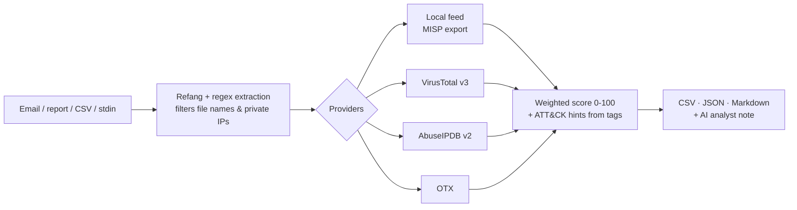

# AI-Powered IOC Enrichment Engine


Paste a phishing email, an incident write-up, a firewall export or a CSV of indicators. The engine
**extracts and refangs IOCs** (IPs, domains, URLs, emails, MD5/SHA-1/SHA-256, CVEs), **enriches them
with VirusTotal, AbuseIPDB and AlienVault OTX** (or an offline MISP-style feed), scores each one,
suggests **MITRE ATT&CK** techniques from the intel tags, and writes an **AI analyst note** with what to
block and what to hunt for.

> **Target role:** Threat Intelligence Analyst · SOC Analyst · Vulnerability Analyst

## Pipeline



## Quick start (offline, no API keys)

```bash
git clone https://github.com/Shanker869/ai-ioc-enrichment-engine.git
cd ai-ioc-enrichment-engine
python -m ioc_engine.cli extract data/sample_phishing_report.txt
python -m ioc_engine.cli enrich  data/sample_phishing_report.txt --context "user in finance clicked the link"
python -m ioc_engine.cli enrich  data/sample_iocs.csv --column indicator
pip install pytest && pytest -q
```

Example output: [`examples/enrichment_report.md`](examples/enrichment_report.md) ·
[`examples/enriched_iocs.csv`](examples/enriched_iocs.csv)

## Live threat intel

All three have free tiers:

```bash
export VT_API_KEY=...          # virustotal.com -> profile -> API key
export ABUSEIPDB_API_KEY=...   # abuseipdb.com/account/api
export OTX_API_KEY=...         # otx.alienvault.com -> settings
```

Online lookups are cached for 24 h in `.ioc_cache.json` to save quota. Provider errors (rate limit,
404) are recorded in the output instead of crashing the run.

### AI note

`LLM_PROVIDER=ollama | openai | anthropic` (see `.env.example`). Default `none` gives a rule-based note.

## Scoring

`score = strongest weighted provider score + 15% of the second strongest` (capped at 100).
Weights: VirusTotal 1.0 · local feed 1.0 · AbuseIPDB 0.9 · OTX 0.7.
≥70 malicious · 30-69 suspicious · <30 clean · no data = unknown.

## Layout

```
ioc_engine/
  extract.py    regex extraction, refang/defang, private-IP and file-name filtering
  providers.py  LocalFeed, VirusTotal, AbuseIPDB, OTX + cache
  enrich.py     score fusion, ATT&CK tag mapping, AI narrative
  cli.py        extract / enrich commands
data/local_intel.json   offline intel in a MISP-like shape (edit or export your own)
```

## Skills shown

IOC extraction · threat-intel APIs · data enrichment and scoring · MITRE ATT&CK ·
Python automation · LLM-assisted reporting

## References and credits

Built while studying (no code copied):
[RH-ISAC/PyOTI](https://github.com/RH-ISAC/PyOTI) ·
[ryuk27/ioc-threat-intel](https://github.com/ryuk27/ioc-threat-intel) ·
[hartescout/rich-iocs](https://github.com/hartescout/rich-iocs) ·
[SreejithReji/soc-python-tools](https://github.com/SreejithReji/soc-python-tools) ·
[splinterlabs/osint-agent-public](https://github.com/splinterlabs/osint-agent-public) ·
[MISP/MISP](https://github.com/MISP/MISP)

## License

MIT
