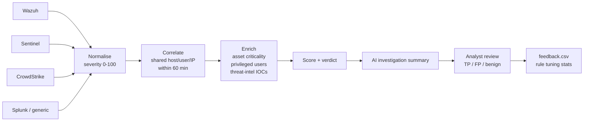

# AI SOC Alert Triage Assistant


A home-lab triage assistant for Tier-1 SOC work. It takes alerts from **Wazuh, Microsoft Sentinel,
CrowdStrike Falcon or any SIEM**, correlates them into incidents, enriches them with asset, identity
and threat-intel context, scores them, and writes an **AI investigation summary** with an
escalate / investigate / close recommendation. Analysts then record their verdict, and that
feedback shows which rules produce false positives.

> **Target role:** SOC Analyst I/II · Security Operations Analyst · Incident Response Analyst · SIEM Analyst

## Pipeline



### Scoring

| Factor | Points |
|---|---|
| Highest alert severity (normalised) | base |
| Each extra correlated alert | +3 (max +15) |
| Kill-chain progression across 3+ ATT&CK tactics | +15 |
| Asset criticality 4-5 | +10 |
| Privileged account involved | +10 |
| Threat-intel match (IP or SHA-256) | +20 |

**≥70 escalate · 40-69 investigate · <40 close as benign**

## Quick start

```bash
git clone https://github.com/Shanker869/ai-soc-alert-triage.git
cd ai-soc-alert-triage
python -m venv .venv && source .venv/bin/activate
pip install pytest

python scripts/generate_sample.py
python -m soc_triage.cli triage data/sample_alerts.json --context data/context
python -m soc_triage.cli review reports/incidents.json INC-0001 true_positive --notes "LSASS dump confirmed in EDR"
python -m soc_triage.cli stats reports/feedback.csv
pytest -q
```

Sample output: [`examples/sample_triage_report.md`](examples/sample_triage_report.md). The sample feed
contains a phishing → PowerShell → persistence → LSASS dump → RDP → shadow-copy deletion chain
that gets correlated into one incident across two hosts.

### AI backend

```bash
export LLM_PROVIDER=ollama      # free, local (ollama pull llama3.1)
export LLM_PROVIDER=openai      OPENAI_API_KEY=...
export LLM_PROVIDER=anthropic   ANTHROPIC_API_KEY=...
```

Default `none` gives a rule-based summary, so the tool still works with no model.

### REST API (for SOAR / n8n / Wazuh integrations)

```bash
pip install fastapi uvicorn
uvicorn soc_triage.api:app --reload
curl -X POST localhost:8000/triage -H 'Content-Type: application/json' -d @data/sample_alerts.json
```

## Hook it to a real lab

1. Build a small lab: Wazuh manager + a Windows VM with Sysmon + Wazuh agent.
2. Export alerts: `cat /var/ossec/logs/alerts/alerts.json | jq -s '.' > wazuh_alerts.json`
3. Edit `data/context/assets.csv`, `privileged_users.txt` and `threat_intel.json` for your lab.
4. `python -m soc_triage.cli triage wazuh_alerts.json --context data/context`

## Layout

```
soc_triage/
  models.py   vendor normalisers + ATT&CK technique→tactic map
  triage.py   correlation (union-find), enrichment, scoring, AI summary, report
  cli.py      triage / review / stats commands
  api.py      optional FastAPI endpoint
  llm.py      pluggable LLM client
```

## Skills shown

Alert triage · SIEM/EDR data models (Wazuh, Sentinel, CrowdStrike) · alert correlation ·
MITRE ATT&CK · threat-intel enrichment · LLM-assisted investigation · REST APIs · Python testing

## References and credits

Built while studying (no code copied):
[beenuar/AiSOC](https://github.com/beenuar/AiSOC) ·
[Guscyrus-cyber/LLM_Alert_Triage_Investigation](https://github.com/Guscyrus-cyber/LLM_Alert_Triage_Investigation) ·
[dedibagus/aisoc](https://github.com/dedibagus/aisoc) ·
[wazuh/wazuh](https://github.com/wazuh/wazuh) ·
[rootverdict/soc-automation-lab](https://github.com/rootverdict/soc-automation-lab)

## License

MIT
