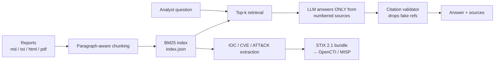

# AI Threat Intelligence Research Assistant (RAG with citations)


Drop threat reports (Markdown, text, HTML or PDF) into a folder and ask questions in plain English.
The assistant retrieves the relevant passages with **BM25 search**, has an LLM answer **only from those
passages with [n] citations**, and **checks the citations** so it can't cite a source that wasn't
retrieved. It also pulls out IOCs, CVEs and **MITRE ATT&CK** techniques and exports everything as a
**STIX 2.1 bundle** you can import into **OpenCTI or MISP**.

> **Target role:** Threat Intelligence Analyst · Threat Research Associate · SOC Analyst

## How it works



## Quick start

```bash
git clone https://github.com/Shanker869/ai-threat-intel-rag-assistant.git
cd ai-threat-intel-rag-assistant
python -m ti_rag.cli ingest data/threat_reports
python -m ti_rag.cli ask "How does COPPERFOX get initial access?"
python -m ti_rag.cli summarize copperfox_q3_report.md
python -m ti_rag.cli export-stix -o reports/stix_bundle.json
pip install pytest && pytest -q
```

The sample reports in `data/threat_reports/` are **fictional** (invented actor COPPERFOX, RFC 5737 IPs).
Replace them with real public reports (CISA advisories, vendor blogs saved as PDF/HTML) for practice.

Example output: [`examples/example_session.md`](examples/example_session.md) ·
[`examples/stix_bundle.json`](examples/stix_bundle.json)

### Use a real model

```bash
export LLM_PROVIDER=ollama      # free, local
export LLM_PROVIDER=anthropic   ANTHROPIC_API_KEY=...
export LLM_PROVIDER=openai      OPENAI_API_KEY=...
```

With no model, an extractive fallback returns the best-matching sentences, still cited.

### Import into OpenCTI

OpenCTI → Data → Import → upload `stix_bundle.json` (connector *ImportFileStix*). The bundle contains
an `identity`, one `report` per document, `indicator` objects (IPs, domains, file hashes) and
`attack-pattern` objects linked to ATT&CK. Deterministic IDs mean re-imports update objects instead of
duplicating them.

## Why BM25 and not embeddings?

BM25 needs no GPU, no vector database and no API calls, and threat reports are full of exact tokens
(hashes, CVE IDs, malware names) where keyword search does very well. Possible next step: add
embeddings with LangChain or LlamaIndex and combine both scores (hybrid search).

## Layout

```
ti_rag/
  index.py    document loading, chunking, BM25 index
  answer.py   cited answers, citation validation, IOC/ATT&CK extraction, STIX export
  cli.py      ingest / ask / summarize / export-stix
```

## Skills shown

Retrieval-augmented generation · prompt design against hallucination · threat report analysis ·
STIX 2.1 · OpenCTI / MISP data models · MITRE ATT&CK · Python

## References and credits

Built while studying (no code copied):
[OpenCTI-Platform/opencti](https://github.com/OpenCTI-Platform/opencti) ·
[MISP/MISP](https://github.com/MISP/MISP) ·
[langchain-ai/langchain](https://github.com/langchain-ai/langchain) ·
[run-llama/llama_index](https://github.com/run-llama/llama_index) ·
[OASIS STIX 2.1 spec](https://docs.oasis-open.org/cti/stix/v2.1/stix-v2.1.html)

## License

MIT
