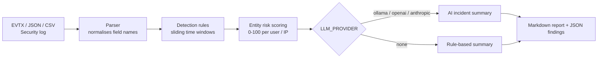

# AI Windows Authentication Log Analyzer


A home-lab SOC tool that reads Windows Security logs (`.evtx`, JSON, JSONL or CSV), detects
credential attacks with rules mapped to **MITRE ATT&CK**, scores risky users and IPs, and writes an
**AI-drafted incident summary** that an analyst can paste into a ticket.

> **Target role:** SOC Analyst I/II · Security Operations Analyst · Incident Response Analyst

## What it detects

| Rule | Detection | Windows Event IDs | MITRE ATT&CK |
|---|---|---|---|
| AUTH-001 | Brute force against one account (N failures in a window) | 4625 | T1110.001 |
| AUTH-002 | Password spraying (one IP, many accounts) | 4625 | T1110.003 |
| AUTH-003 | Successful logon after repeated failures | 4625 → 4624 | T1110, T1078 |
| AUTH-004 | Off-hours network / RDP logon | 4624 (type 3/10) | T1078, T1021.001 |
| AUTH-005 | Account lockout | 4740 | T1110 |
| AUTH-006 | Explicit credentials used for many accounts | 4648 | T1078, T1550 |
| AUTH-007 | New account created | 4720 | T1136 |
| AUTH-008 | Member added to a privileged group | 4728 / 4732 / 4756 | T1098 |
| AUTH-009 | Security log cleared | 1102 | T1070.001 |

## How it works



The rules do the detecting; the AI only explains what the rules found. That keeps results
reproducible and stops the model from inventing alerts.

## Quick start

```bash
git clone https://github.com/Shanker869/ai-windows-auth-log-analyzer.git
cd ai-windows-auth-log-analyzer
python -m venv .venv && source .venv/bin/activate     # Windows: .venv\Scripts\activate
pip install -r requirements.txt pytest

python scripts/generate_sample.py                     # synthetic attack dataset
python -m authlog_analyzer.cli data/sample_security_events.json
pytest -q
```

An example output is in [`examples/sample_report.md`](examples/sample_report.md).

### Turn on the AI summary

```bash
# Free + local
ollama pull llama3.1
export LLM_PROVIDER=ollama

# or a hosted model
export LLM_PROVIDER=openai     OPENAI_API_KEY=sk-...
export LLM_PROVIDER=anthropic  ANTHROPIC_API_KEY=sk-ant-...
```

With `LLM_PROVIDER=none` (the default) or if the model is unreachable, a rule-based summary is used.

## Use it on real logs from your lab

Export the Security log from a Windows VM (run PowerShell as Administrator):

```powershell
Get-WinEvent -LogName Security -MaxEvents 5000 |
  Where-Object { $_.Id -in 4624,4625,4648,4720,4728,4732,4740,4756,1102 } |
  ForEach-Object {
    $x = [xml]$_.ToXml(); $row = [ordered]@{ EventID=$_.Id; TimeCreated=$_.TimeCreated.ToUniversalTime().ToString('o'); Computer=$_.MachineName }
    foreach ($d in $x.Event.EventData.Data) { $row[$d.Name] = $d.'#text' }
    [pscustomobject]$row
  } | ConvertTo-Json -Depth 3 | Out-File security.json -Encoding utf8
```

Or copy `C:\Windows\System32\winevt\Logs\Security.evtx` and run the tool on it directly.
Winlogbeat / Wazuh JSON exports also work because field names are normalised.

**Lab idea:** run Hydra or `crackmapexec smb` from a Kali VM against a Windows test VM
you own, then analyse the log. Only attack systems you own or are authorised to test.

## Project layout

```
authlog_analyzer/
  parsers.py      EVTX/JSON/CSV loading and field normalisation
  detections.py   9 detection rules + entity risk scoring
  report.py       AI / rule-based summary and Markdown report
  llm.py          pluggable LLM client (Ollama, OpenAI, Claude, none)
  cli.py          command line interface
scripts/generate_sample.py   synthetic attack dataset (RFC 5737 IPs, fake users)
tests/                       pytest suite, run in GitHub Actions
```

## Skills shown

Windows event log analysis · detection engineering · MITRE ATT&CK mapping · Python ·
LLM integration · incident reporting · CI with GitHub Actions

## References and credits

This lab was built while studying these open-source projects (no code copied):

- [JuttSahib1999/ai-security-log-analyzer](https://github.com/JuttSahib1999/ai-security-log-analyzer): EVTX + local LLM + ATT&CK mapping idea
- [Fareshesham0/security-log-analyzer](https://github.com/Fareshesham0/security-log-analyzer): authentication parsing and risk scoring
- [JPCERTCC/LogonTracer](https://github.com/JPCERTCC/LogonTracer): visualising suspicious Windows logons
- [MITRE ATT&CK](https://attack.mitre.org/) technique IDs

## License

MIT
